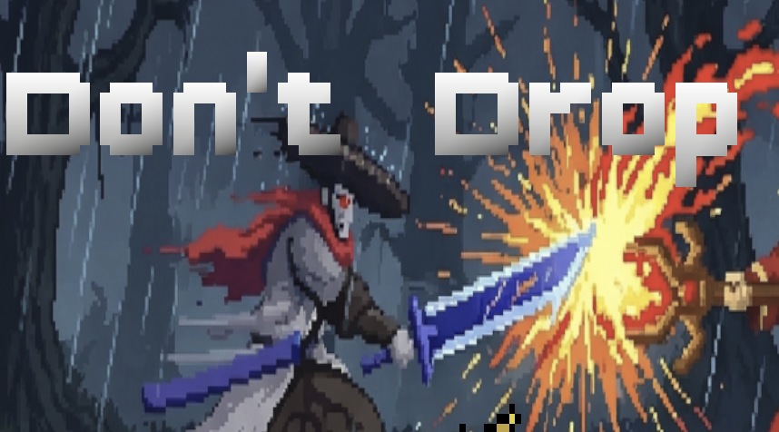
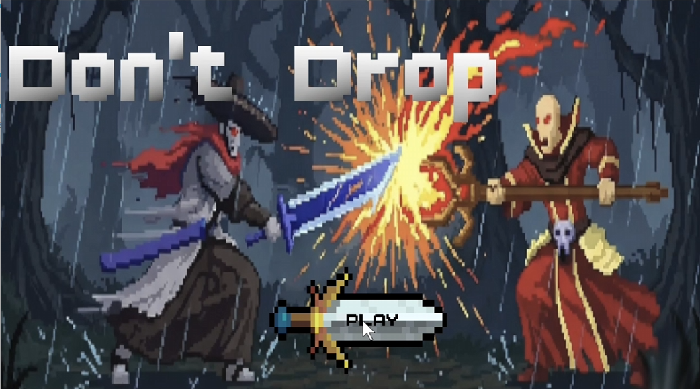
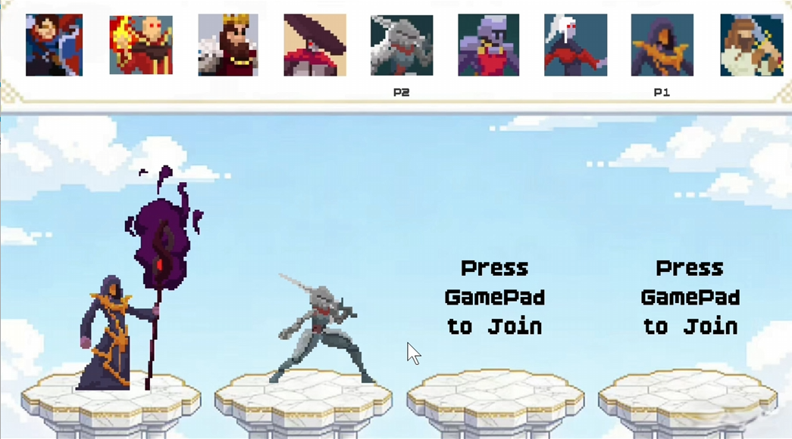
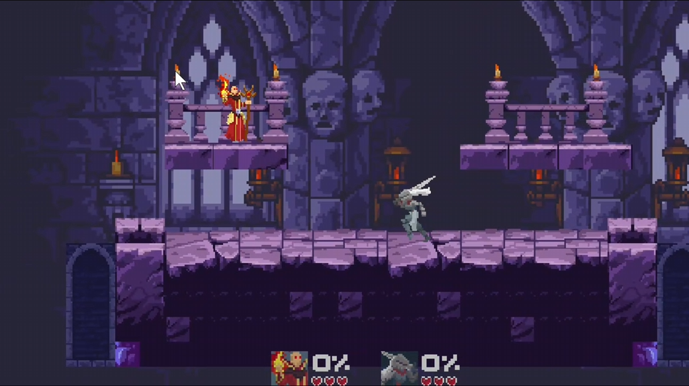
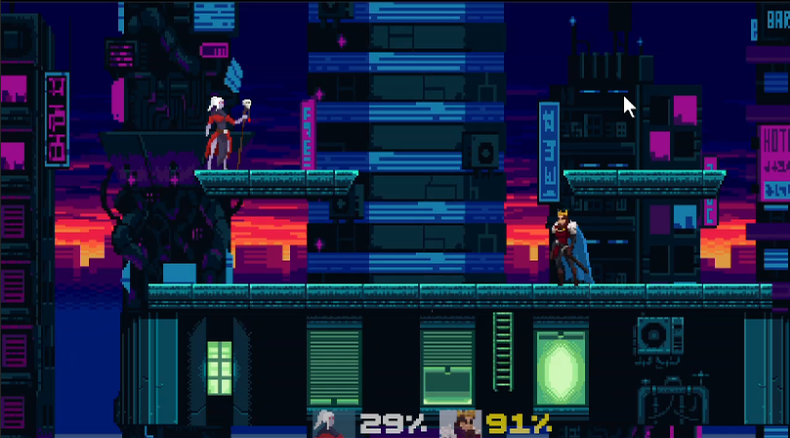
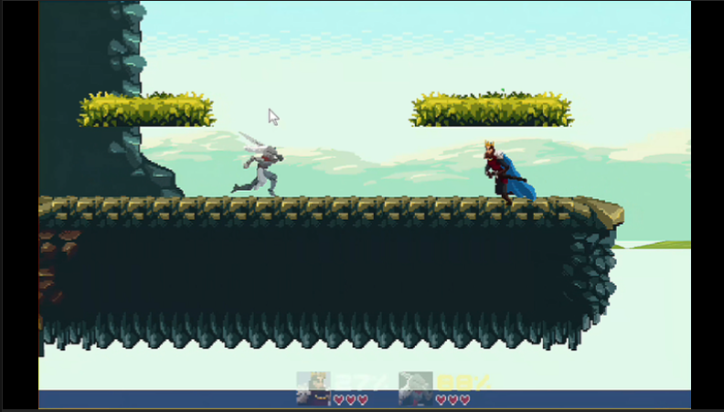

# Don't Drop — Unity WebGL

<p align="center">
  
</p>

## About / 游戏介绍

### English

**Don't Drop!** is a casual multiplayer party fighting game built for fast-paced local battles. Players fight on floating platforms, using movement, double jumps and attacks to knock their opponents off the stage. Each player starts with three lives, and the last player standing wins the match.

The controls are easy to learn, while speed boosts, shields, swords and other items bring unpredictability to every round. With short matches, lively combat and plenty of opportunities for dramatic comebacks, *Don't Drop!* is designed to be a fun, lighthearted game for friends playing together in the same room.

This repository contains the project landing page, a playable Unity WebGL build, gameplay screenshots and the game pitch document.

### 中文

**《Don't Drop》**是一款轻松有趣的本地多人派对对战游戏，强调快节奏的同屏竞技与娱乐体验。玩家将在悬浮平台上移动、二段跳和攻击，设法将对手击落平台。每位玩家初始拥有三条生命，最后存活的玩家即可赢得对局。

游戏操作直观、上手门槛低，同时加入了加速、护盾、剑等随机道具，让每一轮战斗都充满变化与逆转。凭借紧凑的对局节奏和富有互动性的战斗设计，《Don't Drop》尤其适合朋友聚会时一起游玩。

本仓库包含项目展示页、可直接游玩的 Unity WebGL 构建、游戏截图以及策划展示文档。

## Screenshots / 游戏截图

<table>
  <tr>
    <td></td>
    <td></td>
    <td></td>
  </tr>
  <tr>
    <td colspan="3" align="center">
      
      
    </td>
  </tr>
</table>

## 在线内容

- 项目主页：打开根目录的 `index.html`
- 开始游戏：进入 `game/index.html`
- 游戏策划展示：`docs/game-pitch.pdf`
- 演示视频：[哔哩哔哩](https://www.bilibili.com/video/BV1xsQMBfEtf/)

## 游戏特色

- 2–4 人本地同屏对战
- 移动、二段跳、下平台与攻击操作
- 鞋子、红心、剑等随机道具
- 快节奏、易上手的聚会玩法

## 操作说明

| 玩家 | 移动 | 跳跃 | 下平台 | 攻击 |
| --- | --- | --- | --- | --- |
| 玩家一 | `A` / `D` | `W`（二段跳） | `S` | `F` |
| 玩家二 | `←` / `→` | `↑`（二段跳） | `↓` | 右 `Ctrl` |
| 玩家三、四 | 手柄摇杆 | 手柄按键 | 手柄按键 | South 键（Xbox 手柄为 `A`） |

- 按 `R` 重新开始游戏。
- 在选人界面按攻击键加入，再次按攻击键确认；所有玩家确认后进入选图。

## 本地运行

Unity WebGL 构建不能直接通过 `file://` 协议正常加载，请在仓库根目录启动一个本地 HTTP 服务：

```bash
python -m http.server 8000
```

然后访问 <http://localhost:8000/>。也可以使用任意静态文件服务器，例如 VS Code Live Server。

## 项目结构

```text
.
├── index.html                  # 项目展示主页
├── assets/
│   └── images/                 # Logo 与游戏截图
├── docs/
│   └── game-pitch.pdf          # 游戏策划展示
└── game/
    ├── index.html              # Unity WebGL 入口
    ├── Build/                  # Unity WebGL 构建产物
    ├── StreamingAssets/        # Unity StreamingAssets
    └── TemplateData/           # Unity WebGL 页面资源
```

## 开发团队

- 张健源（Zhang Jianyuan），西安交通大学
- 王议甲（Wang Yijia），西安交通大学
- 刘远浩（Liu Yuanhao），西安交通大学
- 李欣泽（Li Xinze），西安交通大学

## 技术栈

- Unity WebGL
- HTML / CSS / JavaScript

## 说明

`game/Build/` 中包含体积较大的 Unity WebGL 二进制文件。克隆和首次加载可能需要一些时间。

